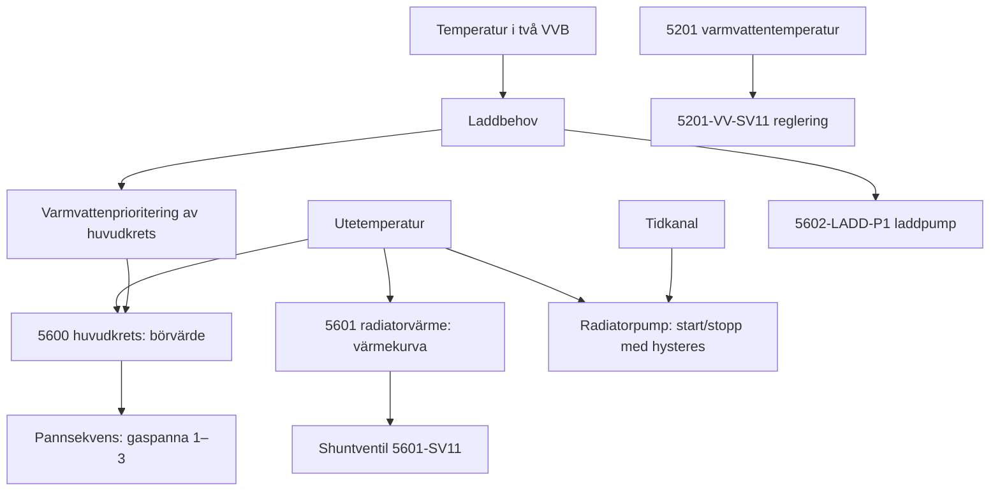

# BASTEC – styrsystem i undercentralen

**Ny dokumenterad DUC-backup:** [19 november 2026 kl. 20.40](backup-2026-11-19/README.md), bekräftad av beställaren. Den används för aktuell konfigurationshistorik. Nedanstående avsnitt beskriver det äldre underlaget 2014–2015 och har inte skrivits över.

Undercentral/pannrum, Högalidsvägen 69. Detta är **historisk dokumentation från 2014–2015**, godkänd för registrering av beställaren 2026-11-19. Nyare dokumentation är inte känd. Dagens konfiguration är ännu inte hämtad eller verifierad. Underlaget föregår värmepumparna från 2019.

## Utrustning och identitet

| Objekt | Modell enligt underlaget | Antal | Individuellt serienummer |
|---|---|---:|---|
| DUC1 | BASTEC BAS2 XE16-COM | 1 | Saknas |
| DUC1:1 | BASTEC BAS2 E16 | 1 | Saknas |
| DUC1:2 | BASTEC BAS2 E16 | 1 | Saknas |

Apparatskåpet benämns AS1/AS-DUC1. Elritningens materiallista styrker DUC och expansionsmoduler. Datablad finns även för operatörspanel **OP-FG15W1**, Produal **TEP Pt1000** och **TF25**, men ett bifogat datablad styrker inte ensamt exakt installerad panel eller varje givare. Installationsdag och individuella serienummer är okända. Skåpslayout anger 800 × 800 × 250 mm. Elritning E63:501, projekt 56901048101, relationsdatum 2014-12-11. BAS2-utskrifter daterade 2015-04-13 är inte bevis för driftsättningsdag.

## Funktionsöversikt

Flödesbilden UC01 och funktionsbeskrivningen skiljer på 5600 pann-/huvudkrets, 5601 radiatorvärme samt 5201 varmvatten/VVC. Funktionsutdrag och konfiguration finns som sökbara filer nedan; detta schema återger funktionella samband, inte verifierad rördragning.

- **Pannsekvens:** huvudkretsens 5600-GT11 regleras efter utetemperaturberoende börvärde. Tre pannor går in stegvis och därefter ett gemensamt högeldningssteg. Regulator 4 har P-band 60 °C, I-tid 300 s, D-tid 0 s och avvikelsegräns 3 °C. Stegintervall 0–15, 15–30, 30–45 och 45–100 %. De tre första har utsignal 0–40 %; sista 0–100 %.
- **Varmvattenprioritering:** huvudkretsens börvärde höjs enligt funktionstexten till inställbara 65 °C vid laddning; normaldrift återgår över 59 °C. Laddning startar under 54 °C och slutar över 59 °C. Funktionstexten anger uttryckligen **maxvärdet** av VVB-GT11 och VVB-GT12; detta har inte ändrats till minvärde vid registreringen.
- **Radiatorvärme:** 5601-GT11 reglerar 5601-SV11 efter utetemperatur. Regulator 5 har P-band 25 °C, I-tid 300 s, D-tid 0 s, avvikelsegräns 3 °C. Pumpstart vid låg utetemperatur med hysteres samt motionskörning via tidkanal.
- **Varmvatten/VVC:** regulator 6 har konstant börvärde 55 °C och påverkar 5201-VV-SV11. Skilj detta från laddgränserna ovan.
- **Katastrofförregling:** enligt funktionstexten bryts pannornas matning när katastrofreläet faller, bland annat vid spänningsbortfall, brännarluckkontakt och högtryckspressostat. Fysisk säkerhetskedja hålls åtskild från framtida Modbus-funktioner.

Historisk radiatorkurva (utetemperatur → framledning, °C): −16 → 62,5; −6,5 → 56; −1,7 → 50,2; 3 → 43,5; 6,7 → 37,8; 10,8 → 31,2; 15 → 23,5. Värdena är dokumenterade inställningar 2015, inte rekommenderade nya inställningar.

## Signaler, I/O och plintar

Plintlistans modul:kanal måste alltid kombineras med **UI, DO eller AO**; samma nummer kan förekomma i olika signalkategorier. Det är inte samma numrering som skåpets X-plintar.

| Modul/kategori | Kanaler | Funktion |
|---|---|---|
| DUC1 UI 1:1–1:3 | DI 1–3 | Summalarm panna 1–3 |
| DUC1 UI 1:4 | DI 4 | 5600-EXP1 lågt/högt tryck, värmesystemets stora expansionskärl |
| DUC1 UI 1:5–1:8 | DI 5–8 | Auto/drift radiatorpump och laddpump |
| DUC1 DO 1:1–1:3 | DO 1–3 | Manöver radiatorpump, laddpump, VVC-pump |
| DUC1 AO 1:1–1:4 | AO 1–4 | Pannsignal 1–3, radiatorventil SV11 |
| E16 nr 1 UI 2:1–2:2 | DI 9–10 | VVC-pump Auto/drift |
| E16 nr 1 UI 2:3–2:8 | AI 11–16 | Ute GT10, huvudkrets GT11, radiator GT11, huvudkrets GT21, radiator GT21, VVB-GT11 (tank 2) |
| E16 nr 1 AO 2:1 | AO 5 | 5201-VV-SV11 |
| E16 nr 2 UI 3:1–3:3 | AI 17–19 | VV-GT11 framledning, VVC-GT21 retur, VVB-GT12 (tank 1) |

Historisk kapacitet: 24 UI, 12 DO, 12 AO. Använt i plintlistan: 19 UI (10 DI, 9 passiva AI), 3 DO, 5 AO. Övriga kanaler anges oanvända i detta underlag; det bevisar inte lediga kanaler idag.

Elritningens blad 35 (PDF-sida 24) visar kommunikationsplint X7: 701–704 inkommande kommunikation, 705/706 Modbus A/B, 707–710 utgående kommunikation och 711/712 M-Bus. En ritad anslutning bevisar inte aktiv användning eller en registerkarta. Originalritning krävs vid elarbete; inte alla 24 ritningssidor har transkriberats.

## Larm och uppföljning

Larmutskriften innehåller **20 larm** med grupp, fördröjning och standardkvittering. Fullständiga rader finns i projektutdraget och exporttabellen.

| Typ | Grupp | Fördröjning |
|---|---:|---:|
| Huvudkretsens temperaturavvikelse | 2 | 7200 s |
| Radiator-/varmvattentemperaturavvikelse | 2 | 3600 s |
| Givarfel huvudkrets/radiator/VVC-retur | 3 | 60 s |
| Givarfel varmvattenframledning | 2 | 60 s |
| Givarfel VVB-GT11 | 1 | 60 s |
| Panna 1–3 summalarm | 1 | 30 s |
| Expansionskärl lågt/högt tryck | 2 | 60 s |
| Tre pumpar ej i Auto | 2 | 3600 s |
| Tre pumpar driftfel | 2 | 60 s |

Ett separat givarfelslarm för VVB-GT12 framgår inte av denna lista. Gruppernas siffror har inte översatts till nya prioritetsklasser. Konfigurationsutdraget bevarar även tidkanaler, pumpfunktioner, loggdefinitioner, räknare, digitala/analoga minnen och PLC-tabell med ursprungliga fält och kodvärden. Ett definierat loggobjekt är inte en importerad mätserie.

## Underhåll och felsökning

Pärmens instruktioner är **generella mallar**, inte bevis för att alla nämnda komponenter finns här. De tar bland annat upp motorers driftåterkoppling, motorskydd/säkring, säkerhetsbrytare, 24 V manövermatning, manuell/Auto-ställning, rimliga givarvärden och avvikelsegränser. Underhållstexten behandlar ventilställdon, spjällställdon, fuktgivare och rökdetektorer. Ventilationsfrysskydd och rökdetektorer ska inte registreras som installerade bara för att mallen nämner dem. Originaltexten finns i projektutdraget. Detta är historiskt serviceunderlag, inte ett protokoll över utförd service eller nya driftinstruktioner.

## Avvikelser och öppna frågor

- Funktionstextens utegivare GT41 motsvaras i flödesbild/plintlista av 5600-GT10; beteckningsskillnaden bevaras.
- Funktionstextens GT51 och pumpnamn P1/P2 är inte entydigt identiska med I/O-listans VV-GT11, VVC-P1 och 5602-LADD-P1. Kontrollera mot aktuell konfiguration innan signalerna används.
- Inga individuella serienummer identifierade. Exakt panelmodell behöver verifieras.
- Idrifttagningsprotokollet har handskrivna kontroller daterade 7/7 utan säkert årtal. Det och elritningarna är inte fullständigt transkriberade; källhänvisningarna gör det möjligt att fortsätta.

## Modbus och nästa jämförelse

XE16-COM-databladet beskriver Modbus TCP/RTU. Den historiska exportens MODBUS1-objekttabell innehåller endast avslutningsrad och inga konfigurerade objekt. Det är **inte** bevis för att extern läsning/slavfunktion saknas. Ingen aktuell registerkarta, slavadress eller aktiv anslutning är verifierad.

Nästa underlag bör vara en daterad export/säkerhetskopia av aktuell BAS2-anläggning, gärna med versionsuppgifter och aktuella bilder av flödesbild samt kommunikationsinställningar. Jämför utrustning/I/O, signalnamn, PLC-villkor, värmekurvor, börvärden, tidsfunktioner, larm, loggdefinitioner och Modbus mot 2015. Bevara originalexporten i dokumentarkivet; granska användare, anslutningar och eventuella inloggningsuppgifter före registrering. Ingen hämtning från anläggningen eller ändring av styrning har gjorts i denna registrering.

## Sökbara underlag

- [Projektutdrag: funktion, plintlista, larm, regulatorer och generella serviceinstruktioner](projektutdrag-2015.yaml)
- [Utvalda konfigurationstabeller](konfiguration-2015.yaml) – ursprungliga exportfält, delvis ännu inte avkodade.
- [Dokumentförteckning med filnamn, sidantal och kontrollsummor](../../inventering/importer/bastec-2026-11-19.yaml)
- [Utrustningsregister](../register.yaml)

Originalritningar, programinstallation och hela konfigurationsarkivet har inte lagts i repot. Dokumentförteckningen omfattar pärmens 31 PDF:er, inte installationsprogrammets övriga manualbibliotek.
